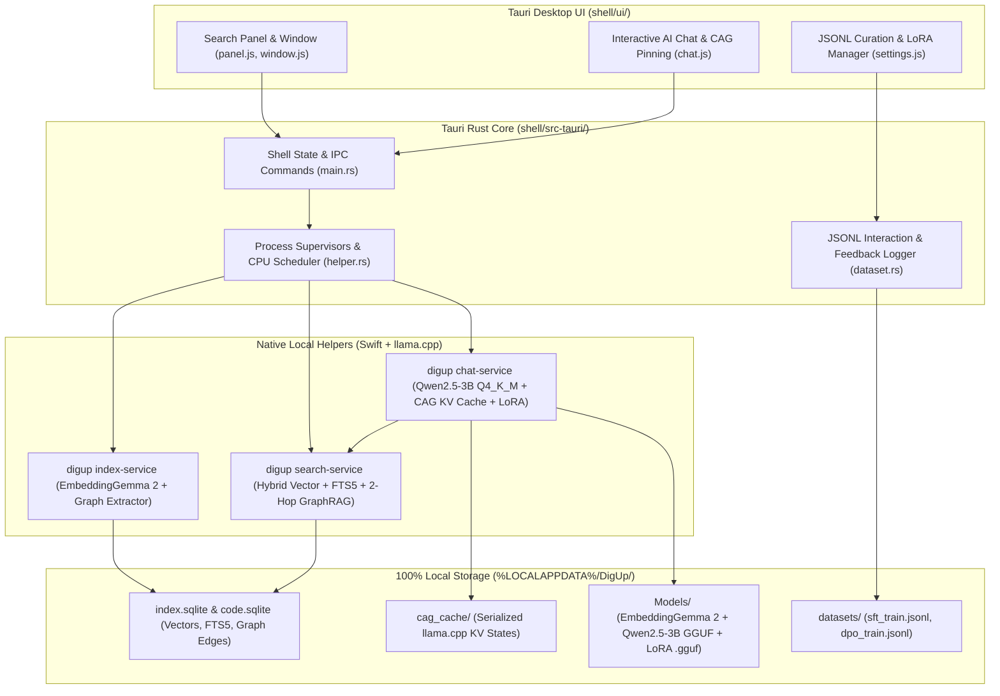

# Architecture & Implementation Plan: Local Private DigUp + SLM Desktop System (CAG, GraphRAG & JSONL Fine-Tuning)

## Overview & Objective

This document defines the architecture, open-source Small Language Model (SLM) selection, and phased engineering plan to fork and extend [`ARahim3/DigUp`](https://github.com/ARahim3/DigUp) (`v0.7.0-beta.2` Windows/Linux Tauri + Swift/llama.cpp engine) into a **100% private, air-gapped multimodal search and interactive AI assistant**.

Designed specifically for an **8-core CPU, 12GB RAM PC (CPU-only / integrated graphics)**, the system combines:

1. **DigUp Multimodal Search (`EmbeddingGemma 2`)**: 768-d shared embedding space across photos, screenshots, PDFs, documents, audio (30s windows), video frames, and source code (`index.sqlite` and `code.sqlite`) plus FTS5 exact-word matching.
2. **Local Open-Source SLM (`Qwen2.5-3B-Instruct-Q4_K_M`)**: Runs natively via `llama.cpp` in a supervised helper process (`digup chat-service`) with `Q8_0` KV-cache quantization and CPU thread scheduling.
3. **Cache-Augmented Generation (CAG)**: Uses `llama.cpp` sequence state serialization (`llama_state_seq_save_file` / `llama_state_seq_load_file`) to persist pre-computed KV caches of pinned files, folders, and system prompts to disk (`cag_cache/`), cutting CPU Time-To-First-Token (TTFT) from ~15s to <200ms.
4. **Lightweight Deterministic SQLite GraphRAG**: Zero-LLM-overhead graph extraction (`edges` table in `IndexStore` Schema v6) capturing code imports, symbol definitions, shared exact identifiers (invoice numbers, error codes, ticket IDs), markdown/document links, and folder hierarchy for 1-to-2 hop context expansion.
5. **Interactive JSONL Fine-Tuning Pipeline & LoRA Hot-Swapping**: Captures approved/edited user-assistant chat turns and retrieved context into standard ChatML SFT (`sft_train.jsonl`) and DPO (`dpo_train.jsonl`) datasets with automatic secret scrubbing, paired with runtime `.gguf` LoRA adapter loading (`llama_adapter_lora_init`).

---

## 1. Hardware Budget & Open-Source SLM Research (8-Core CPU, 12GB RAM)

### Memory Allocation Budget (12.0 GB Total System RAM)

| Component                                    | Memory Footprint      | Notes                                                                                                                      |
| :------------------------------------------- | :-------------------- | :------------------------------------------------------------------------------------------------------------------------- |
| **Windows OS & Core Services**               | ~3.80 GB              | Baseline OS footprint                                                                                                      |
| **DigUp Tauri Desktop Shell**                | ~0.35 GB              | Rust supervisor + WebView2 UI                                                                                              |
| **DigUp `search-service`**                   | ~0.40 GB              | `EmbeddingGemma 2` Text-Only `Q8_0` (310 MB) + FP16 vector matrix                                                          |
| **DigUp `index-service`**                    | _0.00 GB during chat_ | Automatically paused/exited during active SLM generation so the 555 MB vision/audio `mmproj` never contends for RAM or CPU |
| **DigUp `chat-service` (SLM + 8K KV Cache)** | ~2.30 GB              | `Qwen2.5-3B-Instruct-Q4_K_M.gguf` (1.93 GB) + 8,192-token `Q8_0` KV cache (~350 MB)                                        |
| **Free System Headroom**                     | **~5.15 GB**          | Prevents Windows pagefile thrashing and keeps UI responsive                                                                |

### Model Evaluation Matrix (CPU-Only 8-Core Target)

| Model (`Q4_K_M` GGUF)           | File Size   | RAM (8K Ctx) | 8-Core CPU Speed | RAG Grounding & Tool Use                   | Recommendation              |
| :------------------------------ | :---------- | :----------- | :--------------- | :----------------------------------------- | :-------------------------- |
| **`Qwen2.5-3B-Instruct`**       | **1.93 GB** | **~2.30 GB** | **18–26 tok/s**  | **Excellent** (JSON, citations, multi-hop) | **Primary Default**         |
| **`Qwen2.5-1.5B-Instruct`**     | 1.12 GB     | ~1.40 GB     | 35–45 tok/s      | Good (fast summaries, simple Q&A)          | **Turbo / Low-RAM Option**  |
| **`Qwen2.5-Coder-3B-Instruct`** | 1.93 GB     | ~2.30 GB     | 18–26 tok/s      | Superior on `code.sqlite` repositories     | **Code-Specialized Option** |
| **`Llama-3.2-3B-Instruct`**     | 2.02 GB     | ~2.40 GB     | 17–24 tok/s      | Strong general instruction following       | **Supported Alternative**   |

---

## 2. System Architecture

---

## 3. Phased Development & Artifact Structure

Each phase records its design artifacts, obstacle analyses, verification logs, and test outputs in its dedicated phase folder under `phases/`:

- `phases/phase1_repo_and_llama_runtime/` — Upstream `ARahim3/DigUp` clone, `llama.cpp-no-logits.patch` analysis & modification for dual embedding + causal generation, C/Swift header bindings.
- `phases/phase2_model_management/` — `ModelFiles.swift` & `DownloadModel.swift` extensions for `Qwen2.5-3B-Instruct-Q4_K_M.gguf` and offline/LoRA model verification.
- `phases/phase3_sqlite_graphrag/` — `IndexStore.swift` Schema v6 (`edges` table), deterministic entity/code/document graph extraction, and 1-to-2 hop GraphRAG expansion in `Searcher.swift` & `SearchService.swift`.
- `phases/phase4_chat_and_cag_service/` — `LlamaGenerator.swift` & `ChatService.swift` (`digup chat-service`), CPU thread & KV-cache tuning (`Q8_0`), CAG disk state save/load, and 2-hop agentic search loop.
- `phases/phase5_jsonl_finetuning_pipeline/` — `dataset.rs` JSONL interaction logger (ChatML SFT & DPO formats), PII/secret redaction, LoRA `.gguf` hot-loading, and offline LoRA training utility (`scripts/train_lora.py`).
- `phases/phase6_tauri_ui_and_tests/` — Tauri Rust IPC integration (`main.rs`, `helper.rs`), Frontend UI (`window.html`, `window.js`, `panel.html`, `panel.js`, `settings.html`), and automated test suites.

---

## 4. Key Obstacles & Engineering Insights Identified Upfront

1. **Obstacle 1: Upstream `scripts/llama.cpp-no-logits.patch` Breaks Text Generation**
   - _Discovery_: DigUp applies a custom patch to `llama.cpp` that forces output logits allocation off to save ~1 MiB per token across `EmbeddingGemma 2`'s 262k vocabulary. If we load a causal SLM (`Qwen2.5-3B`) into that patched `libllama`, token sampling crashes or returns garbage because no logits are computed.
   - _Solution_: Modify `scripts/llama.cpp-no-logits.patch` so logits suppression only activates when `cparams.embeddings == true`. When `cparams.embeddings == false` (causal chat mode), `llama.cpp` computes logits solely for the final token in the prompt batch (`batch.logits[last] = 1`), keeping memory overhead near zero (~600 KB for 1 token) while enabling full `llama_sampler` generation.
2. **Obstacle 2: CPU & RAM Contention Between `index-service` and `chat-service`**
   - _Discovery_: On an 8-core, 12GB RAM CPU-only machine, if `index-service` is embedding video frames or PDFs (using 8 threads and ~1 GB RAM) while the user starts an AI chat (needing 6 threads and ~2.3 GB RAM), CPU cache thrashing will halve token generation speed.
   - _Solution_: Add an automatic preemption hook in `shell/src-tauri/src/main.rs` (`chat_ask`) that signals `index-service` to pause (`set_paused` / `stop`) while a chat stream is active, and resumes indexing once chat goes idle.
3. **Obstacle 3: Prompt Re-Evaluation Latency on CPU-Only Hardware**
   - _Discovery_: Feeding 3,000 tokens of retrieved documents on every turn of a conversation takes ~20 seconds per turn on a CPU.
   - _Solution_: Combine **CAG** (`llama_state_seq_save_file` / `llama_state_seq_load_file`) for pinned files/system prompts with persistent session KV state in `LlamaGenerator`, so follow-up questions only evaluate the new user message (~30–100 tokens, <0.5s).
4. **Obstacle 4: Preventing Sensitive Data Leakage into Fine-Tuning `.jsonl` Files**
   - _Discovery_: Even though everything stays local, users generating `.jsonl` files from their chats might inadvertently capture `.env` secrets, API tokens, or private keys in a prompt.
   - _Solution_: Build a deterministic regex + entropy scrubber into the JSONL logger (`dataset.rs`) that strips API keys, bearer tokens, PEM blocks, and high-entropy secrets before writing any line to `sft_train.jsonl` or `dpo_train.jsonl`.
