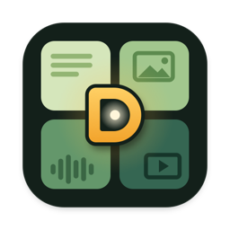

<p align="center"></p>

<h1 align="center">DigUp</h1>

<p align="center"><b>Describe it. Dig it up.</b><br>
Search the files on your computer by what's in them, with Google DeepMind's
<a href="https://huggingface.co/google/embeddinggemma-2">EmbeddingGemma 2</a>.</p>

<p align="center"><a href="https://github.com/ARahim3/DigUp/releases/latest"><b>Download for Mac</b></a> ·
<a href="https://github.com/ARahim3/DigUp/releases/tag/v0.7.0-beta.1"><b>Windows and Linux (beta)</b></a><br>
<sub>Free and open source. Everything runs on your computer.</sub></p>

<p align="center"></p>

EmbeddingGemma 2 is the multimodal embedding model Google DeepMind released in October 2026. It puts text, images,
audio and video into one shared space: a photo of a dog on a beach lands next to the words "a dog on the beach", and a
recording of someone talking about sleep lands next to "where they talk about sleep". It understands more than 100
languages, it's open (Apache 2.0), and at 740M parameters it's small enough to run on a laptop.

DigUp brings that to the files on your computer, on a Mac, on Windows or on Linux. Pick the folders to search, and it
reads the pictures, PDFs, documents, recordings and videos in them. Then describe what you're looking for, in your own
words, and it finds the match, whatever kind of file it is.

## What you can find

- "zebra in a video" opens the clip at the moment the zebra shows up
- "where they talk about sleep" jumps to that minute of a podcast
- "the clause about pets in the lease" shows the PDF page
- "a dog on the beach" finds the photo, and "payment declined error" the screenshot
- a search in English can find a note written in Bengali, Arabic or any of the model's 100+ languages, and the other
  way around
- "code: retry a failed call with backoff" finds the function in your projects, if you turn on code search

Exact words count too. Invoice numbers, error codes and names are matched as written, in file names and document text,
so a search gets both the meaning and the exact string. On a Mac that includes the text inside screenshots.

## Private

Nothing you index leaves your computer. DigUp goes online only to download the model once and to check for updates
once a day. The update check sends nothing about your files, and you can turn it off. No account, no telemetry.

## Install

**Mac.** Download the DMG from [Releases](https://github.com/ARahim3/DigUp/releases/latest) and drag DigUp to
Applications, or use Homebrew: `brew install --cask arahim3/tap/digup`. It needs an Apple Silicon Mac with macOS 14 or
later.

**Windows.** Download `DigUp_x.y.z_x64-setup.exe` from the
[beta release](https://github.com/ARahim3/DigUp/releases/tag/v0.7.0-beta.1) and run it. It installs for you only, with
no admin rights. Windows may say it doesn't recognize the app, because the installer isn't signed yet: choose More
info, then Run anyway. It needs 64-bit Windows 10 or 11.

**Linux.** On Ubuntu, Debian, Mint and the like, download the .deb and install it:

```sh
sudo apt install ./DigUp_x.y.z_amd64.deb
```

The package is called `dig-up`, because Debian already has an unrelated `digup`. Anywhere else, download the
AppImage, make it executable and run it. Both are for 64-bit Intel and AMD processors and work on Ubuntu 22.04,
Debian 12, Mint 21 and newer.

Then, on any of them:

1. Open DigUp. While the model downloads (865 MB, once), pick the folders to search: whole folders, or only some of
   their subfolders. DigUp shows how long the first pass will take for each, measured on your computer.
2. Press the shortcut in any app and describe what you're looking for: **⇧⌘Space** on a Mac, **Ctrl+Shift+Space** on
   Windows and Linux.

DigUp keeps itself up to date: the Mac app, the Windows installer and the AppImage install updates with one click.
With the .deb, DigUp tells you when there's a new version and opens its release page.

## Using it

| Mac | Windows and Linux | What it does |
|---|---|---|
| ⇧⌘Space | Ctrl+Shift+Space | Opens the search panel from any app (you can change it) |
| ↓ ↑ | ↓ ↑ | Moves through the results |
| ↩ | Enter | Opens the result: PDFs at the page, recordings and videos at the moment, code in your editor at the line |
| Space | Space | A big preview, at the page or moment (once you've moved to a result) |
| ⌘↩ | Ctrl+Enter | Shows it in Finder, Explorer or your file manager |
| ⌘C | Ctrl+C (in the window) | Copies the file, to paste anywhere |
| ⌘O | Ctrl+O | The same search in a bigger window, with a picture grid and filters |

DigUp lives in the menu bar on a Mac and in the tray on Windows and Linux, where you can see how indexing is going,
pause it, or open Settings. Opening it from the Start menu or your app list shows the search window.

A few things differ by system:

- On a Mac, a video opens at its moment in QuickTime Player (macOS asks once whether DigUp may control it) or IINA,
  and a PDF opens in Preview with your words in its search. On Windows and Linux, PDFs open at the page in your PDF
  viewer if it's one that can be told a page (Edge, Chrome, Firefox, Acrobat, SumatraPDF, Evince, Okular), and
  recordings and videos at the moment in VLC, mpv or MPC-HC. Other apps open the file from the start; the big
  preview plays it from the moment either way.
- On GNOME and KDE under Wayland, which don't let apps set their own shortcuts, DigUp adds Ctrl+Shift+Space to the
  desktop's keyboard settings during setup, and you change it there. On other Wayland desktops, Settings shows the
  command to give a shortcut of your own.
- On GNOME, the tray icon needs the AppIndicator extension, which Ubuntu includes. Without it, the window's ⋯ menu has
  the same items.

## What it reads

Only the folders you choose:

- pictures and screenshots (JPEG, PNG, HEIC, WebP and more), by what they show, and on a Mac screenshots by their text
  too
- PDFs, page by page, scans included. A long one gets its first 30 pages right away and the rest once everything
  else is in (up to 5,000 pages a file)
- documents: txt, md, rtf, docx, odt, html, and on a Mac doc, long ones the same way. Text that's mostly numbers,
  like a data export, is matched by its exact text only
- audio of any length: the model listens to 30 seconds at a time, so DigUp takes overlapping 30-second windows and a
  match points to its moment
- video of any length: a frame every few seconds, one per shot, plus the soundtrack the same way as audio

Outside the folders you pick for code search, it never reads code, and inside a code project (a folder with `.git`,
`package.json` and the like) it reads only screenshots. It never reads keys, certificates, password files, hidden
folders like `.ssh`, apps or caches. It skips folders that look like datasets, and never downloads files that only
live in the cloud (iCloud on a Mac, OneDrive on Windows). You can skip more folders or file types in Settings. DigUp
only reads your files; it never changes, moves or uploads them.

The first pass happens once. On a Mac it takes a few minutes for a few hundred files and can take an hour for a big
Downloads folder. On Windows and Linux, DigUp runs the model on the graphics card where that's faster and on the
processor otherwise; on a processor alone a picture takes a few seconds (about five on a 2017 laptop's Core i5), so a
large photo library can take hours, which is why setup shows the time first. After that, a new file is searchable a
few seconds after it lands.

## Code

EmbeddingGemma 2 reads code too, so DigUp can search your projects. Code search is off until you turn it on, in
Settings → Code or during setup, for the folders you pick. Each repo shows how long reading it takes and how much room
its index needs. Then start a search with `code:` and say what the code does, or type a name that's in it:

- "code: retry a failed call with backoff" finds the function, whatever it's called
- "code: refreshAccessToken" goes to the line that defines it, not the places that call it
- "code: plot how many examples each class has" finds the notebook cell

Results open in your editor at the line: Zed, VS Code, Cursor, Sublime Text, JetBrains IDEs and a few more, Xcode on
a Mac and Notepad++ on Windows (pick one in Settings). Code has an index of its own and never shows up in other
searches. DigUp reads source files, notebooks (without their outputs) and a repo's own docs. It skips what git
ignores, vendored and generated code, data files, and anything that looks like a key or a password. While you're
working on code, the index catches up a minute after things go quiet.

On a Mac, reading code takes about 20 seconds for a small app, and about 20 minutes and 130 MB of index for all of
llama.cpp.

## How it works

```
your folders ─► readers that turn files into pictures, text and sound
             ─► EmbeddingGemma 2 on llama.cpp, in a helper process that quits when it's done
             ─► one SQLite file: a vector for every picture, page, passage, video frame and 30 s of sound,
                plus a keyword index (code search keeps a second one, for code)
your words   ─► the same model's text part (~250 MB, only while you search) ─► nearest vectors + exact words
```

DigUp runs ggml-org's 8-bit build of EmbeddingGemma 2 through [llama.cpp](https://github.com/ggml-org/llama.cpp): on
the Mac's GPU with Metal, and on Windows and Linux on the GPU with Vulkan when a quick check at setup finds it faster
than the processor and getting the same results. Every vector lives in the same 768-dimensional space, which is why
one query can rank a video frame against a PDF page. A search embeds your words in milliseconds and compares them with
everything in the index. Exact-word matches get a boost, because no embedding holds an invoice number exactly.

The search engine is the same Swift code on every system. On a Mac it reads files with macOS's own frameworks (ImageIO,
PDFKit, AVFoundation, and Vision for the text in screenshots) and the app is SwiftUI. On Windows and Linux it reads
them with PDFium, ffmpeg, stb and miniz, and the app around it is built with [Tauri](https://tauri.app).

The index remembers which model version made its vectors. An update that leaves the vectors unchanged keeps your
index, and a test checks every llama.cpp update against stored reference vectors before it ships.

## Build from source

On a Mac you'll need Xcode 26, git, and CMake (or `uv`) for llama.cpp. If `xcode-select -p` shows the Command Line
Tools, switch to Xcode first (`sudo xcode-select -s /Applications/Xcode.app`): they lack the SwiftUI and Swift Testing
macros the build needs.

```sh
git clone https://github.com/ARahim3/DigUp && cd DigUp
scripts/build-llama.sh            # llama.cpp at a pinned tag, with a one-line patch (a few minutes)
swift build -c release && swift test
./build.sh                        # → build.noindex/DigUp.app
```

On Windows and Linux you'll need Swift 6.4, Rust and Node; on Windows also Visual Studio's C++ build tools, with the
commands run in Git for Windows' bash. `scripts/fetch-vendor.sh` and `scripts/build-llama.sh` get the libraries, then
`scripts/package-linux.sh` makes the .deb and the AppImage, and `scripts/package-windows.sh` the installer.
[The packages workflow](.github/workflows/packages.yml) has every step, down to the packages each system needs.

There's also a command-line tool, `.build/release/digup`, that indexes, searches and runs the evals from the terminal
(`digup --help`). `scripts/make-testbed.sh` builds a folder of test files to try it on on a Mac (it needs ffmpeg), and
`evals/` holds the queries ranking changes are measured with.

## FAQ

**How is this different from Spotlight or Windows Search?** They find files by their names, text and metadata. DigUp
also finds them by what they show or say, and takes you to the page or moment. They work fine side by side.

**What's different on Windows and Linux?** The search is the same: the same model, the same results. Two things are
missing for now. The text inside screenshots isn't read yet, so a screenshot is found by what it shows rather than by
an exact code typed into the search. And doc files from old Word versions, RAW photos and SVG pictures are only read
on a Mac.

**Why is the download 865 MB?** That's the model: the text part (310 MB) and the image and audio encoders (555 MB).
The app itself is about 20 MB on a Mac, and on Windows and Linux 40 to 140 MB depending on the package, since those
carry their own PDF, video and image readers.

**Will it slow my computer down?** Only the first pass is heavy. After that it reads new files only. The model runs in
a separate process that quits when it's done, and the search side only loads while you're searching.

**Which languages?** The model knows more than 100, and DigUp searches in all of them, across languages too. The evals
cover only English, Bengali and Arabic because those are the languages of the files DigUp was tested on, and Google
notes that the model isn't equally strong in every language. Two limits apply to exact words, not to meaning: the
text inside screenshots is read only on a Mac, by Apple's text recognition, which knows about 25 languages, and
languages written without spaces, like Chinese, Japanese and Thai, aren't split into words.

**How do I remove it?**
On a Mac, quit it, then delete DigUp.app and `~/Library/Application Support/DigUp`, which holds the model and the
indexes. Its settings are in `~/Library/Preferences/com.abdurrahim.DigUp.plist`. With Homebrew, `brew uninstall --cask
--zap digup` removes all of it.
On Windows, uninstall it in Settings → Apps; tick "Delete the application data" to remove the model and the index too.
On Linux, `sudo apt remove dig-up` (or delete the AppImage), then delete `~/.local/share/digup` (the model and the
index), `~/.config/com.abdurrahim.DigUp`, `~/.local/share/com.abdurrahim.DigUp` and, if it opened at login,
`~/.config/autostart/DigUp.desktop`. On GNOME, also remove its shortcut in Settings → Keyboard.

## Support

DigUp is free and open source, and it stays that way. If it helps you and you'd like to support it, you can
[buy me a coffee](https://arahim3.gumroad.com/l/support).

## Thanks

DigUp is built on [EmbeddingGemma 2](https://huggingface.co/google/embeddinggemma-2) by Google DeepMind (Apache 2.0)
and [llama.cpp](https://github.com/ggml-org/llama.cpp) (MIT). The Mac app uses [Sparkle](https://sparkle-project.org)
(MIT) for updates. The Windows and Linux app is built with [Tauri](https://tauri.app) (MIT or Apache 2.0) and reads
files with [PDFium](https://pdfium.googlesource.com/pdfium/) (BSD), [FFmpeg](https://ffmpeg.org) (LGPL),
[stb](https://github.com/nothings/stb) (public domain) and [miniz](https://github.com/richgel999/miniz) (MIT). Their
license notices ship with the app.

DigUp isn't affiliated with Google, Apple or Microsoft. Gemma is a trademark of Google LLC; Mac and Spotlight are
trademarks of Apple Inc.; Windows is a trademark of Microsoft Corporation.

## License

MIT
