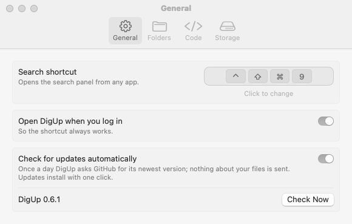
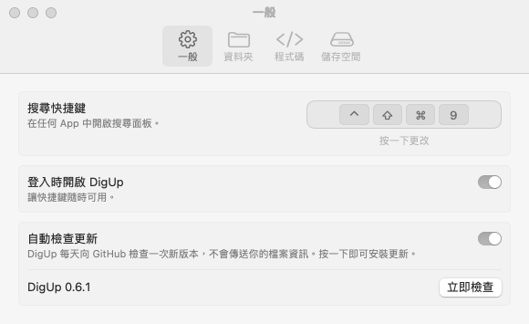
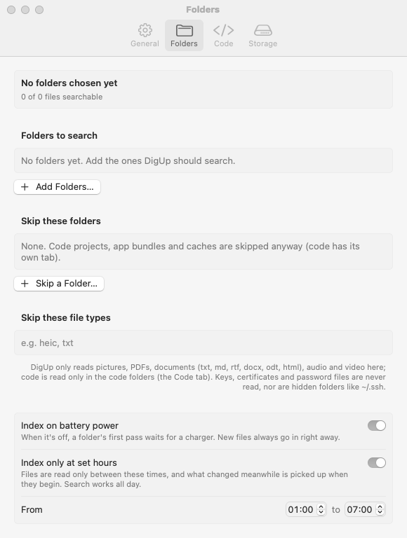
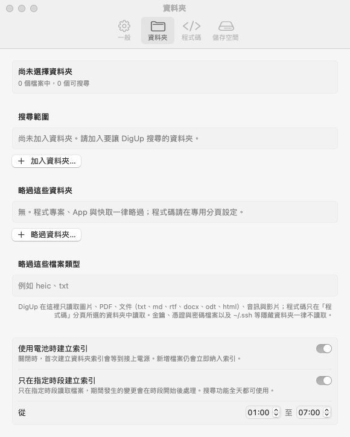

# Interface localization

DigUp follows the language selected for the app in macOS, with English as its development language and fallback.
Traditional Chinese uses `zh-Hant`, including the system's `zh-TW` preference.

The `DigUpLocalization` target contains `L10n` and these resources:

```
Sources/DigUpLocalization/Resources/
├── en.lproj/       Localizable.strings, InfoPlist.strings
└── zh-Hant.lproj/  Localizable.strings, InfoPlist.strings
```

`L10n.text` looks up static interface text. `L10n.format` formats display values with positional `%1$@`, `%2$@`, etc.
The English format is also the lookup key. Pass already formatted strings (for example a count's `.formatted()` value),
and escape a literal percent as `%%` in format strings. Translations may reorder or omit an argument; Chinese need not
include an English singular/plural noun supplied by the calling code. Keep both English noun forms for existing English
plural behavior. `String(format:)` duration formats such as `%.1f h` are translated before their existing formatting call.

To add a language, add its `.lproj` directory with both files and the same interface keys. Keep permission descriptions
consistent with the English Info.plist. Run `swift test`, build with `./build.sh`, and inspect the packaged app's UI in
both languages, including long explanatory text and strings with counts, percent signs, and file names.

`build.sh` embeds the SwiftPM resource bundle in `Contents/Resources`. It also copies each language's `InfoPlist.strings`
into the main app bundle so macOS can localize its permission prompts. This step matters: launching from the build
folder alone does not prove that the distributed `.app` includes its translations.

Search terms, tokenizer behavior, model prompts, file paths, stored settings keys, helper commands and diagnostics are
not localized. Sample queries shown in the UI may be translated; they are examples, not changes to search processing.
System error descriptions and third-party UI use the localization supplied by macOS or the dependency.

## Example: the same build in two languages

| English | Traditional Chinese |
| --- | --- |
|  |  |


## DigUp 0.6.1 coverage

The localized UI includes indexing hours, the next indexing time, code waiting for other files, and manual model-file
selection (including file-size/check errors). The same build continues to use English for unsupported languages.

| English indexing hours | Traditional Chinese indexing hours |
| --- | --- |
|  |  |

Validation on macOS: 97 tests passed (86 DigUpKit, 6 LlamaRuntime including reference vectors, 5 localization),
`./build.sh` and strict deep signature verification passed. Fourteen isolated packaged-app runs checked onboarding,
General/Folders/Code/Storage settings and search in English and `zh-TW`, plus `zh-Hant` scheduling and unsupported
French fallback. Permission descriptions were verified as packaged resources; live macOS permission dialogs were
not triggered. Helper/system error messages use their existing source language when they have no UI translation.

## Independent regression coverage (2026-10-20)

The localization tests also check that `zh-TW`, `zh-Hant`, and `zh-Hant-TW` select the Traditional Chinese resources,
and that an unsupported French preference selects the English resources and wording. These are resource-selection
tests, not a new packaged-app UI run.

PR #112 already proposes the repeated Traditional Chinese result-count correction, receipt example localization,
and localization checker scripts. Those changes remain in #112 rather than being copied into this PR update.
Han filename and body search changes remain outside this localization PR.
