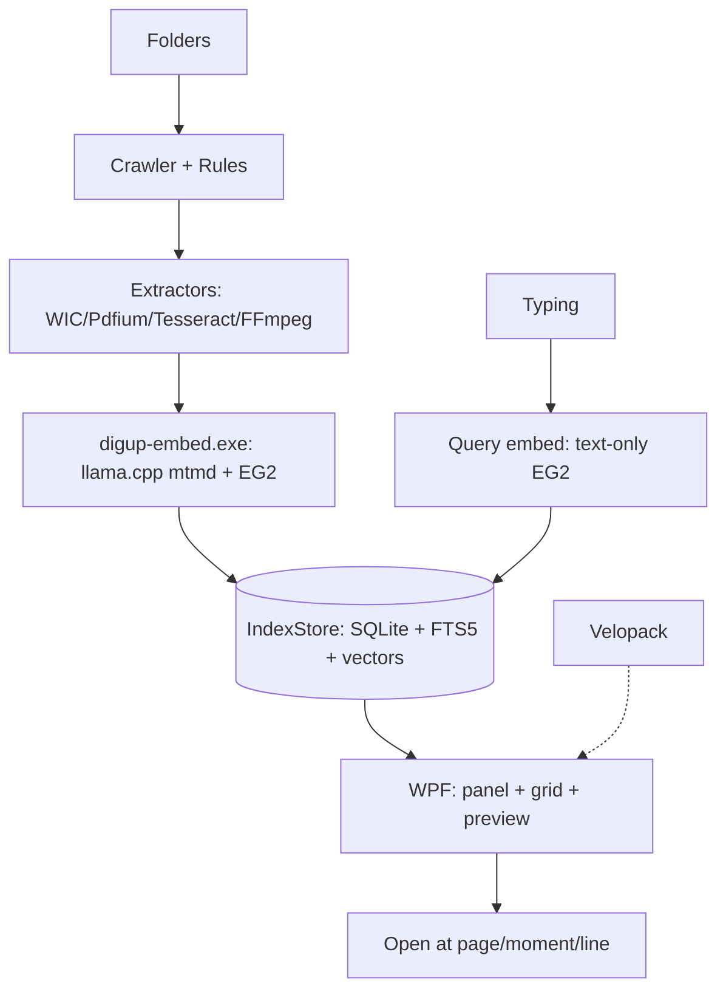
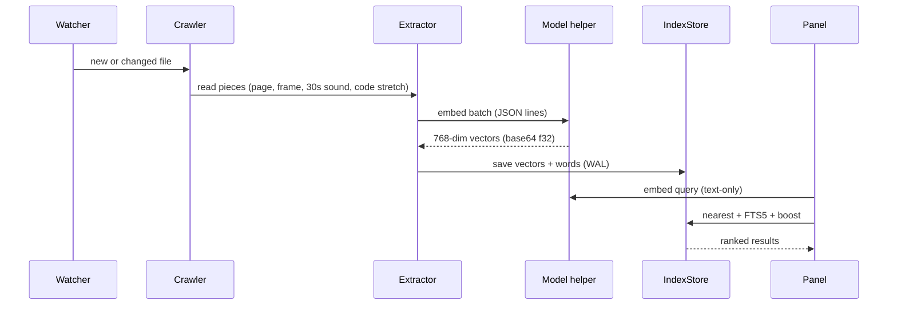

# DigUp Windows Port — Plan

## Approach Summary

Rebuild DigUp from scratch for Windows as a native, fast app. Keep the core the same: EmbeddingGemma 2 (text + image + sound in one 768-number space), one SQLite file for vectors + word search, and a small helper that runs the model and quits when done. Throw away all Mac-only parts (SwiftUI, AppKit, Metal, MLX, Sparkle, PDFKit, Vision, AVFoundation). New shell is WPF on .NET 9 (no web, no Electron). Model runs on llama.cpp for Windows (CUDA first, Vulkan next, CPU last). Files are read with WIC (pictures), Pdfium (PDFs), Tesseract (text in screenshots), FFmpeg (sound and video). Updates use Velopack per user (no admin). All files live in one app folder + `%LocalAppData%\DigUp`. Nothing is added to PATH. Nothing needs admin. The app never changes user files. Docs are in simple technical English.

## User Choices (Locked)

- UI: WPF on .NET 9.
- Ship: Velopack, per user, no admin.
- PCs: must run on all PCs (NVIDIA + AMD + Intel + CPU-only).
- Docs: for everyday user + builder, simple words, hard words only when needed.
- Core: EmbeddingGemma 2 stays. No swap.

## Design Decisions

1. **Boundary changes:**
   - IN: file walk, read (image, PDF, doc, sound, video, code), embed with EG2, SQLite + FTS5 + vector search, tray, global hotkey, search panel + big window, previews, thumbs, settings, onboarding, updater, CLI helper, tests, evals, docs.
   - OUT: all Mac code (DigUpApp SwiftUI, LlamaRuntime Metal, MLX worker, Sparkle, build.sh, entitlements). Mac app stays as is. No shared UI code.
   - New repo area: `windows/` so Mac build never breaks. Mac `build.sh` is not touched.
2. **Data/artifact flow:**
   - `folders -> crawler (rules, gitignore, skips) -> extractors (WIC, Pdfium, Tesseract, FFmpeg) -> digup-embed.exe (llama.cpp + mtmd, EG2 Q8_0 + mmproj) -> IndexStore (SQLite WAL, float16 vectors, FTS5) -> search (text-only EG2 load while typing, nearest vectors + word boost) -> open at page/moment/line`.
   - Extraction runs one batch ahead of embedding so disk read and GPU work overlap.
3. **Temporal choreography:** Phase 1 proves EG2 on Windows. Phase 2 proves file reading. Phase 3 proves index + search. Only then build UI, packaging, and polish. No UI before search scores match Mac.
4. **Constraints & trade-offs:**
   - Speed: helper quits when idle. Query embed is text-only (~250 MB) and loads only while searching. Vectors are float16 + memory-mapped. First full index is heavy once, then only new files.
   - Ship: self-contained .NET, bundled native DLLs, bundled FFmpeg/Pdfium/Tesseract, no use of what the builder happens to have installed. NVIDIA driver is the only outside need (it is already part of Windows).
   - Safety: per-user install, no admin, no PATH change, no registry writes outside own keys, clean uninstall removes all. Installer never touches system folders.

## Architecture Cleanliness

Vault priming set `concepts/system-design-101/*` was looked for on 2026-10-10 and does not exist in this vault (checked `C:\projects\personal\Obsidian_Knowledge_Graph`, no `concepts/system-design-101` folder). Per skill rules, no content is made up. Inline rules used instead:

- One job per part: walk, read, embed, store, search, show. A part never does another part's job.
- Same shape in, same shape out: EG2 stays 768 numbers, same prompts (`task: search result | query: ...`), same page/moment/line pointers, so Mac evals still count.
- Slow work off the UI thread: embed and read never block typing. Panel shows first results in ms.
- Small resident part: tray + panel stay light. Heavy model process starts on need and quits after.
- No extra tools: each outside tool (FFmpeg, Pdfium, Tesseract, sqlite-vec, Velopack) must earn its place. No web shell. No cloud. No telemetry.
- Safe by default: read-only on user files, skip keys/caches/hidden/placeholders, pause on low power, full rescan on watcher overflow.

## Architecture Visualization

## Phase Breakdown

### Phase 1 — Model core on Windows (EG2 stays)

- **Wave:** 1
- **Executor:** core-implementer
- **Complexity:** MEDIUM
- **Tasks:**
  1. Pin llama.cpp tag b11461, port `llama.cpp-no-logits.patch` to Windows build, turn on `GGML_CUDA + GGML_VULKAN + LLAMA_BUILD_MTMD`, tools/server off.
  2. Build `digup-embed.exe` helper with same JSON-lines protocol as Mac (`info/text/image/audio/quit`, base64 f32, per-item errors, zero vector on fail).
  3. Load same model files (`embeddinggemma-2-Q8_0.gguf` 310 MB + `mmproj-embeddinggemma-2-Q8_0.gguf` 555 MB), same prompts, same 768 dim, same `vectorVersion` check.
  4. Run `ReferenceVectorTests` parity (>= 0.9997 cosine vs `Tests/LlamaRuntimeTests/Reference/vectors.json` for photo/screen/speech). Fail = stop.
- **Input:** `Sources/LlamaRuntime/*.swift`, `Sources/CLlama/*`, `scripts/build-llama.sh`, `scripts/llama.cpp-no-logits.patch`, `Tests/LlamaRuntimeTests/*`.
- **Output:** `windows/embed/` + `windows/bin/digup-embed.exe` + native DLLs (x64 CUDA/Vulkan/CPU, ARM64 CPU) + parity log.
- **Verification:** `digup-embed.exe --self-test` prints cosine scores; `ctest`-style run shows all >= 0.9997; query embed < 50 ms on RTX 5070 Ti after warm-up.
- **Failure handling:** `fixable` once (patch or flag fix). Still red -> `needs_replan` (new tag only with user OK, else stop).

### Phase 2 — File reading without Mac libs

- **Wave:** 2
- **Executor:** core-implementer
- **Complexity:** MEDIUM
- **Tasks:**
  1. Port `Crawler + Rules + FolderSelection` to C#: same skips (keys, certs, hidden, caches, bundles, datasets, OneDrive placeholders, code-project screenshot-only rule, gitignore, vendored/generated skip).
  2. Build extractors: WIC (HEIC/JPEG/PNG/RAW/WebP), Pdfium (text per page + render scan/slide to image, first 30 pages fast then rest, 5000-page cap), docs (txt/md/rtf/doc/docx/odt/html, number-heavy = words only), Tesseract for screenshot text, FFmpeg for 30 s sound windows (25 s step) + video keyframes (one per shot, max one per 3 s) + soundtrack.
  3. Match Mac `MediaPiece`/`Piece`/`Modality` shapes (page, page_image, chunk, ocr, audio, frame, lines, cells) so index format stays close.
  4. Test on `scripts/make-testbed.sh` output (needs FFmpeg at build time only, not at ship).
- **Input:** `Sources/DigUpKit/Crawler.swift`, `Rules.swift`, `Extractors.swift`, `MediaExtractors.swift`, `CodeExtractor.swift`, `FolderSelection.swift`.
- **Output:** `windows/core/DigUp.Core/` (crawler, rules, extractors) + extractor tests.
- **Verification:** testbed file count in = pieces out matches Mac within 2%; no missed PDF page; no key file ever read (negative test).
- **Failure handling:** `fixable` once per extractor. Wrong text = fix lib flags, not new lib, unless approved.

### Phase 3 — Index + search parity

- **Wave:** 3
- **Executor:** core-implementer
- **Complexity:** LARGE
- **Tasks:**
  1. Port `Database + IndexStore + Indexer + Searcher + SearchText + Vectors + Estimator + ModelFiles` to C#: SQLite WAL, FTS5, float16 mmap store (MemoryMappedFile), per-modality score norm, word boost (names, numbers, error codes), code index split from main index.
  2. Keep `Indexer` overlap (extract one batch ahead), text-only query path, helper-quits-when-done, low-power and charger rules (Windows power API).
  3. Run `evals/*.json` (synthetic, code, multilingual bn/ar) and match Mac top-5/MRR within 5%.
  4. Add Windows-only tests: watcher overflow -> rescan, placeholder files never fetch, 30-page PDF fast path.
- **Input:** `Sources/DigUpKit/Database.swift`, `IndexStore.swift`, `Indexer.swift`, `Searcher.swift`, `SearchText.swift`, `Vectors.swift`, `Estimator.swift`, `Model.swift`, `ModelFiles.swift`, `evals/*.json`.
- **Output:** `windows/core/DigUp.Core/` full + `windows/bin/digup.exe` CLI (`estimate/index/search/status/eval`) + eval report.
- **Verification:** `digup.exe eval` shows parity; `digup.exe search "zebra in a video"` opens clip at moment in manual check; unit tests green.
- **Failure handling:** score gap -> `needs_replan` (check prompts/norm/boost before touching model).

### Phase 4 — WPF app shell (fast, no web)

- **Wave:** 4
- **Executor:** ui-implementer
- **Complexity:** LARGE
- **Tasks:**
  1. Build WPF app: tray icon (H.NotifyIcon), `RegisterHotKey` (default Shift+Alt+Space, remappable, Win+Space clash warned), borderless search panel, big window with image grid + filters, settings, onboarding (folder pick + code opt-in + time/space estimates), status menu with pause.
  2. Wire `Engine + AppModel + FolderWatcher (FileSystemWatcher 32-64 KB, debounce, Error -> rescan) + PowerPolicy + ModelDownload (range resume, SHA-256)`.
  3. Open actions: video/sound at moment (seek arg), PDF at page with words marked, code at line in VS Code/Cursor/VS/JetBrains/Sublime/Notepad++ picker, copy file, show in Explorer, Space = preview.
  4. Keep resident RAM low (< 150 MB idle without model), panel open < 100 ms, typing never blocks.
- **Input:** `Sources/DigUpApp/*.swift` (all 27), Phase 3 CLI.
- **Output:** `windows/app/DigUp/` (WPF) + hotkey/tray/watcher code + editor map.
- **Verification:** hotkey opens from any app; offline run uses < 150 MB idle; UI thread never blocked (profiler sample); all open actions checked by hand.
- **Failure handling:** tray/hotkey clash = `fixable` (new default + note). Freeze = stop and profile, no new feature.

### Phase 5 — Ship that leaves Windows alone

- **Wave:** 5
- **Executor:** platform-engineer
- **Complexity:** MEDIUM
- **Tasks:**
  1. Velopack per-user build: self-contained .NET 9, bundled `digup-embed.exe` + native DLLs + FFmpeg + Pdfium + Tesseract data + sqlite-vec, no admin, no PATH, settings + models + index under `%LocalAppData%\DigUp`, clean uninstall.
  2. Sign build, delta updates, daily check (no file data sent, can turn off), first-run model fetch 865 MB once with resume.
  3. Prove safe: install + uninstall on clean Win11 VM, no new services/drivers/startup entries outside own Run key (login item opt-in only), no system file change.
  4. Keep Mac `build.sh`/release flow untouched.
- **Input:** `Resources/Info.plist`, `appcast.xml`, `scripts/release.sh`, `scripts/appcast.py`, Phase 4 app.
- **Output:** `windows/setup/` (Velopack feed + installer) + install/uninstall log + update test.
- **Verification:** VM test: install, run, update to next build, uninstall -> app folder + data gone (if user picks remove data), `autoruns` shows no leftovers except opt-in login item.
- **Failure handling:** any system change outside scope = `escalate` (stop, ask user). No silent fix.

### Phase 6 — Docs + handover in simple English

- **Wave:** 6
- **Executor:** technical-writer
- **Complexity:** SMALL
- **Tasks:**
  1. Write `windows/docs/User-Guide.md` (install, pick folders, search, keys table, code `code:` use, remove) + `windows/docs/Builder-Guide.md` (tools, build, tests, model files, update feed) in simple technical English. Hard words only when needed (example: keep `embedding`, `vector`, `index` and say what they mean once).
  2. Add code map (`what came from which Swift file`), lib list with why each one is there, licenses + `Acknowledgements.txt` (EG2, llama.cpp, Sparkle note -> Velopack, Pdfium, Tesseract, FFmpeg, SQLite).
  3. Short plain-language test sheet a non-expert can follow.
- **Input:** all phase outputs + `README.md` + `Resources/Acknowledgements.txt`.
- **Output:** `windows/docs/*` + root note that points to them.
- **Verification:** fresh reader test (5 tasks done with docs only); word check (no hard word without first-use gloss); all outside tools listed with reason.
- **Failure handling:** `fixable` (rewrite unclear page). No code change here.

## Risk Review

| Category | Applicability | Impact | Evidence Source | Disposition |
|----------|---------------|--------|-----------------|-------------|
| data_volume | applicable | MEDIUM | 5000-page PDF cap, 30-page fast path, float16 mmap store (Mac notes) | mitigated (same caps, streaming windows) |
| performance | applicable | HIGH | RTX 5070 Ti CUDA present, but ship must also do Vulkan/CPU; Metal->CUDA/Vulkan port | mitigated (Phase 1 parity + bench on each backend) |
| concurrency | applicable | MEDIUM | extract-ahead + helper-quits + FileSystemWatcher overflow rule | mitigated (bounded buffers, debounce, rescan) |
| access_control | applicable | HIGH | read-only rule, key/hidden/cache skips, no admin, per-user | resolved (negative tests + VM check) |
| migration_rollback | applicable | MEDIUM | Mac app untouched, `windows/` apart, Velopack deltas + uninstall | mitigated (VM install/update/uninstall log) |
| dependency | applicable | HIGH | No use of local ffmpeg/cuda/dotnet; bundle all; EG2 files pinned by hash | mitigated (SBOM + clean-VM build check) |
| operability | applicable | MEDIUM | Daily update check with opt-out, power/battery pause, simple docs | mitigated (opt-out tested, reader test) |

## Open Questions

1. ARM64 Windows build order — decided: x64 first (user PC is x64), ARM64 CPU-only next, no block on Phase 1.
2. Screenshot OCR engine final pick (Tesseract vs ONNX model) — deferred to Phase 2 A/B on DigUp shots; WinRT OCR is out (needs MSIX identity, clashes with Velopack pick).
3. Chinese/Japanese/Thai word split (Mac has same gap) — deferred: keep Mac gap, note in docs, no new tokenizer in v1.
4. Store listing — decided: no Store/MSIX in v1 per Velopack pick.
